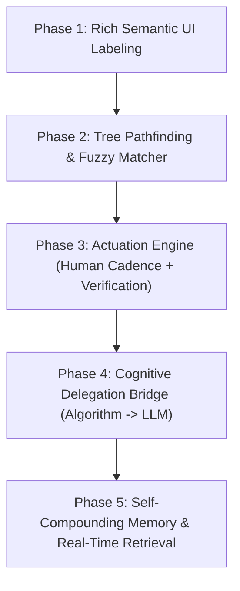

# Momentum AI: Master System Architecture & Implementation Roadmap
**Document Created: October 14, 2026**

---

## 1. The Core Philosophy: Division of Labor

Momentum is neither a dumb RPA script bot nor a naive LLM wrapper. It is a dual-engine autonomous system:

```
┌────────────────────────────────────────────────────────────────────────┐
│                          THE DUAL-ENGINE MODEL                         │
├───────────────────────────────────┬────────────────────────────────────┤
│   ALGORITHMIC ENGINE (Fast / 0ms)  │    COGNITIVE SPECIALIST (LLM)      │
├───────────────────────────────────┼────────────────────────────────────┤
│ • UI Tree Parsing & Semantic Maps │ • Conversational Persona (Witty)   │
│ • Shortest Pathfinding to Goal    │ • Deep Decision Making             │
│ • Fuzzy Match Scoring             │ • Creative Generation (Emails/Copy)│
│ • Physical Actuation (Mouse/Key)  │ • Tone & User Sentiment Modeling   │
│ • State Verification & Feedback   │ • Ambiguity Resolution Dialogue    │
└───────────────────────────────────┴────────────────────────────────────┘
```

The algorithm handles **spatial navigation, UI paths, and physical execution**.  
The LLM handles **thinking, high-level decisions, judgment, and personalized speech**.

---

## 2. Situational Awareness & System Grounding

The agent is never operating blind. At any execution moment, the context window and algorithm have full situational awareness:
- **Temporal Context:** Exact local system time, date, day of week, time zones of relevant contacts.
- **Physical Context:** Machine environment, OS (macOS / Windows), screen resolution, scale factor, frontmost application window bounds.
- **Dynamic Real-Time Web Tools:** Direct capability to query Google, documentation, and external live resources for immediate data retrieval without hallucination.

---

## 3. UI Navigation: Tree Mapping, Fuzzy Matching & Shortest Path

Desktop and web applications are complicated, but they are fundamentally **hierarchical trees with deterministic navigation paths**.

```
Active Window AX Tree
        │
        ▼
┌───────────────────────────────┐
│ 1. Rich Semantic Labeling     │ -> Aggregates Role + Title + Placeholder + 
│                               │    Description + Value into unified identity.
└───────────────┬───────────────┘
                │
                ▼
┌───────────────────────────────┐
│ 2. Fuzzy Match Scoring        │ -> Evaluates intent target against all nodes.
│                               │    Ranks relevance (e.g. LinkedIn Search: 0.92,
│                               │    Tab Search: 0.15).
└───────────────┬───────────────┘
                │
                ▼
┌───────────────────────────────┐
│ 3. Shortest Pathfinding       │ -> Computes minimum necessary action path:
│                               │    Container Focus -> Reveal -> Click/Type.
└───────────────┬───────────────┘
                │
                ▼
┌───────────────────────────────┐
│ 4. State Verification         │ -> Verifies UI changed before next step.
└───────────────────────────────┘
```

### The Pathfinding Rules
- **No Coordinate Guessing:** Elements are located via their semantic labels and relationships in the tree.
- **Contextual Scope:** The tree structure tells the algorithm whether an element belongs to the active workspace (LinkedIn, DaVinci timeline) or the window shell (browser tabs, close buttons).
- **Fuzzy Ranking:** Matches are scored dynamically against the target goal, selecting the exact intended input rather than taking the first naive keyword match.

---

## 4. Actuation Engine: Human-Like vs Turbo

The physical driver ([src/driver.rs](file:///Users/sanjeevn/Downloads/Momentum%20AI/momentum-agent/src/driver.rs)) supports two distinct execution profiles:

1. **Human-Like Mode (Default — 90% of the time):**
   - Natural mouse trajectory and ease-in/ease-out movement.
   - Pre-focus before typing: Click, verify caret presence, clear previous text.
   - Realistic keystroke jitter (40–80ms cadence) to prevent batch-dropping and anti-bot flags.
2. **Turbo Mode (10% of the time):**
   - Direct shortcuts, instant URL dispatch, and accelerated keystrokes when bulk actions or speed are critical.
   - Chosen autonomously based on task urgency and surface safety.

---

## 5. Knowledge Engine: Internal Capability Graph + External Retrieval

The agent does not hardcode platform procedures; it maintains a **self-compounding Knowledge Graph** (`~/.momentum/graph.json`):

1. **Internalized Capability Nodes:**
   - Pre-seeded nodes detailing what platforms can do (LinkedIn, WhatsApp, Blender, Unreal Engine, Circuit Maker, DaVinci Resolve).
   - Lists possible tactics, best contexts, and required inputs.
2. **Dynamic Web Retrieval Fallback:**
   - If an app, platform, or tactic is unknown, the agent performs quick live web queries to inspect the software’s capability, shortcuts, and documentation, then commits new nodes to the graph.
3. **Fluid Relationship & Sentiment Memory:**
   - Open-ended nodes and edges:
     - `person:alex` linked to `platform:google_calendar`.
     - `user --[Dislikes]--> person:alex { "rule": "keep calls under 15m" }`.
   - Remembers what succeeded, what failed, and user preferences permanently.

---

## 6. The Conversational Persona: Witty, Sharp, and Context-Aware

The LLM is not a robotic assistant. It communicates like a sharp, witty co-pilot:
- **Humor Grounded in Knowledge:** When making a joke or remark, it consults user preferences and graph sentiments (knows who the user likes, what industries they work in, what they find annoying).
- **Concise & Decisive:** Asks ONE punchy question only when genuinely missing required information (e.g. unknown contact or missing meeting time).
- **Creative Powerhouse:** When an action calls for generation (e.g., cold outreach pitch, email subject line, video cut log notes), the algorithm hands the prompt to the LLM to write it cleanly.

---

## 7. Step-by-Step Implementation Roadmap



### Phase 1: Rich Semantic UI Labeling
- Update [scripts/mac_ax.swift](file:///Users/sanjeevn/Downloads/Momentum%20AI/momentum-agent/scripts/mac_ax.swift) and [src/perception.rs](file:///Users/sanjeevn/Downloads/Momentum%20AI/momentum-agent/src/perception.rs) to preserve ancestor container context and generate unified semantic labels (Role + Title + Placeholder + Description + Value).

### Phase 2: Tree Pathfinding & Fuzzy Matcher
- Implement generalized fuzzy matching in [src/driver.rs](file:///Users/sanjeevn/Downloads/Momentum%20AI/momentum-agent/src/driver.rs).
- Rank candidate nodes by similarity to the goal; eliminate naive first-match lookups.

### Phase 3: Actuation Engine (Human-Like Dynamics & Honest Verification)
- Add focus-before-typing and human keystroke pacing.
- Enforce state verification: confirm UI changes before advancing milestones.
- Completely remove fake `Ok("Completed intent ...")` returns on unhandled actions.

### Phase 4: Cognitive Delegation Bridge (Algorithm -> LLM)
- Connect generation points (email body, subject, tailored dialogue) directly to the LLM.
- Enforce deterministic halt when an entity or parameter is unresolved.

### Phase 5: Self-Compounding Graph Memory & Live Retrieval
- Integrate real-time web search for unknown app capabilities.
- Persist learned user relationships, platform channels, and sentiments directly to the graph.
