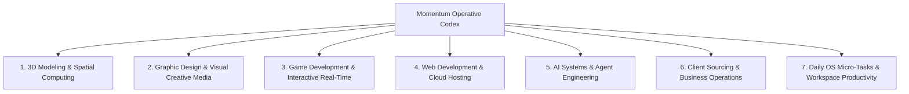
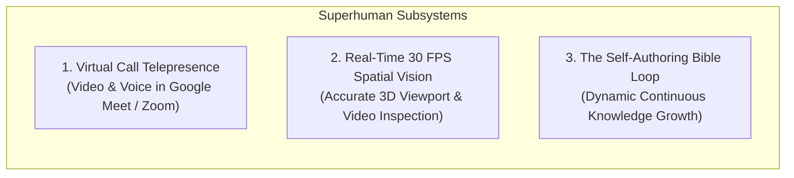

# Momentum AI — The Operative Bible & Master Capability Codex

> **System Status:** Living Operational Codex  
> **Target Environments:** macOS (Apple Silicon Metal) & Windows  
> **Core Architecture:** Autonomous Physical & Digital Agency Across All Industries  

---

## 1. Operating Philosophy: Autonomous UI Agency

Momentum AI is not a brittle macro-runner or a prompt-only chatbot. It is an **autonomous digital operator** that sits beside you, perceives your screens, and adapts fluidly to whatever interface is present.

### The Algorithm Doesn't Need Hardcoded Micro-Rules
Momentum does not need micro-scripted instructions like *"click button at coordinate (450, 220)"* or *"set filter dropdown to $5000"*. 

Because Momentum has **real-time visual perception, Accessibility (AX) tree inspection, and DOM awareness**, it perceives the UI dynamically:
* If it needs to filter on a job board or marketplace, it spots the filter panel on the screen, opens it, and adjusts it.
* If it needs to bevel an edge in Blender, it switches to Edit mode and executes the tool.
* If it hits an authentication wall, it identifies the login screen and coordinates with the user.

The goal of this Codex is to map the **industries, desktop software, web platforms, APIs, and superhuman subsystems** that empower Momentum to operate across the entire digital ecosystem.

---

## 2. Master Industry & Domain Matrix

---

### Domain 1: 3D Modeling & Spatial Computing

Momentum operates 3D viewports, manipulates meshes, handles materials, and prepares assets for production engines and 3D printing.

* **Primary Desktop Applications**:
  * **Blender**: Full modeling, sculpting, geometry nodes, UV editing, rigging, shading, rendering (Cycles/Eevee).
  * **Autodesk Maya**: Character rigging, animation, industrial modeling.
  * **Autodesk 3ds Max**: Architectural visualization, design rendering.
  * **ZBrush**: High-density digital sculpting, dynamic topology.
  * **Tinkercad & SketchUp**: Parametric CAD, rapid prototyping, architectural layouts.
  * **Cinema 4D**: Motion graphics, procedural generation.
* **Primary Web & Cloud Platforms**:
  * **Sketchfab**: 3D model inspection, asset publishing, model downloads.
  * **Spline**: Browser-native 3D design, interactive web embeds.
  * **Poly Pizza / CGTrader / ArtStation**: Asset sourcing, reference discovery.
* **Core Capabilities**:
  * Primitive scaffolding, vertex/edge/face extrusion, subdivision modeling.
  * Mesh health inspection: Non-manifold geometry detection, inverted normals, UV seams.
  * Universal format conversion: `.glb`, `.gltf`, `.fbx`, `.obj`, `.stl`, `.usdz`.
  * Slicer preparation for 3D printing (supports, layer heights, infill).

---

### Domain 2: Graphic Design, Image Editing & Creative Media

Momentum edits raster graphics, generates vector branding, formats visual layouts, and creates marketing collateral.

* **Primary Desktop Applications**:
  * **Adobe Photoshop**: Layer manipulation, masking, smart objects, color grading, retouching.
  * **Adobe Illustrator**: Vector paths, typography, logo design, SVG optimization.
  * **After Effects**: Motion design, visual effects compositing, Lottie animations.
  * **Affinity Photo / Designer**: Standalone creative asset creation.
* **Primary Web & Cloud Platforms**:
  * **Figma**: UI/UX design systems, auto-layout components, prototyping.
  * **Canva**: Rapid template generation, social media assets.
  * **Photopea**: Zero-install web raster editing.
  * **Remove.bg / Unsplash / Coolors**: Palette extraction, asset sourcing, background isolation.
* **Core Capabilities**:
  * Multi-aspect ratio scaling (1:1 square, 9:16 vertical reels, 16:9 banners).
  * Raster-to-vector path tracing.
  * Batch asset export and image optimization.

---

### Domain 3: Game Development & Interactive Experiences

Momentum scaffolds game prototypes, slices sprite sheets, integrates 3D assets, writes gameplay logic, and builds export packages.

* **Primary Desktop Engines**:
  * **Unreal Engine 5**: Blueprints, Nanite/Lumen setups, material graphs.
  * **Unity**: C# gameplay scripting, prefab instantiation, UI Canvas.
  * **Godot 4**: GDScript gameplay nodes, 2D/3D scenes, lightweight builds.
* **Primary Web & Real-Time Frameworks**:
  * **Phaser**: 2D web game scaffolding.
  * **Three.js & Babylon.js**: Browser-based WebGL/WebGPU 3D experiences.
  * **itch.io & Steamworks**: Game publishing, asset packaging, devlog posting.
* **Core Capabilities**:
  * Generating single-file playable web games.
  * Sprite packing, tilemap construction, sound effect triggers.
  * Build automation and deployment to web hosting / game platforms.

---

### Domain 4: Web Development, Cloud Infrastructure & Hosting

Momentum builds websites directly, uses visual web-builders, operates cloud dashboards, and manages full-stack deployments ("Web-to-Web Creation").

* **Primary Cloud & Deployment Platforms**:
  * **Vercel / Netlify**: One-command deployments, preview URLs, serverless functions.
  * **Cloudflare**: Workers, Pages, DNS configuration, edge caching.
  * **Supabase**: PostgreSQL databases, authentication rules, row-level security.
  * **Webflow & Framer**: Visual site design, CMS collection management.
* **Primary Frameworks & Local Tooling**:
  * Next.js, Vite, Tailwind CSS, TypeScript, Bun, Node.js, Playwright, Git.
* **Core Capabilities**:
  * Scaffolding modern, responsive interfaces using Tailwind CSS.
  * CLI deployments (`vercel --prod`, `wrangler deploy`).
  * Live web scraping via Chrome DevTools Protocol (CDP) and DOM extraction.

---

### Domain 5: AI Systems & Agent Engineering

Momentum builds, tests, deploys, and manages AI applications, models, and embeddings.

* **Primary Cloud & API Providers**:
  * **Hugging Face Hub**: Model weight discovery, GGUF downloads, datasets.
  * **OpenRouter / Replicate / Together AI**: Multi-model routing and inference.
  * **Pinecone / Qdrant**: Vector databases for semantic search.
* **Local Engines & Runtimes**:
  * `llama.cpp` / `llama-cpp-2` (Metal / CUDA / CPU quantization).
  * ONNX Runtime, `faster-whisper`, Kokoro TTS, Ollama.
* **Core Capabilities**:
  * Continuous KV prefilling for zero-redundancy prompt streaming.
  * Running local quantized models directly on unified GPU memory.
  * Local codebase semantic retrieval and RAG indexing.

---

### Domain 6: Client Sourcing, B2B Outreach & Agency Growth

Momentum navigates professional networks, identifies project opportunities, compiles prospect lists, and manages agency pipelines.

* **Primary Web Platforms**:
  * **Upwork**: Project listings, contract bids, talent search.
  * **LinkedIn**: B2B prospecting, decision-maker discovery, direct messaging.
  * **Clutch.co**: Agency directories, verified market competitors.
  * **Apollo.io / Wellfound / Crunchbase**: Lead intelligence, startup contracting.
* **Core Capabilities**:
  * Visual navigation of job boards and talent portals using the live UI.
  * Identifying client needs and drafting tailored project proposals.
  * Authentication management: Detecting login barriers and requesting seamless user handoffs.

---

### Domain 7: Daily OS Micro-Tasks & Personal Productivity

Momentum acts as your physical desk assistant for daily computer housekeeping.

* **Native Applications & Tools**:
  * Apple Notes, Obsidian, Notion, TextEdit, Finder / File Explorer, System Keychain.
* **Core Capabilities**:
  * **Voice Scratchpad**: Instantly appending spoken thoughts or code snippets to notes.
  * **Automated Asset Archiving**: Dragging, saving, and naming images or files from web browsers directly into project directories.
  * **OS Housekeeping**: Scanning Downloads, sorting uncompressed archives, inspecting disk space.

---

## 3. Superhuman Subsystem Toolsets (To Be Built)

To elevate Momentum from a capable agent into a truly superhuman companion, three dedicated hardware and sensory toolsets are integrated into the architecture:

---

### 1. Virtual Call Telepresence & AV Loopback Engine

Momentum must be capable of joining video calls directly, projecting its own animated presence on-screen, and speaking through the conference call microphone without conflicting with the user's voice.

* **Virtual Camera Avatar Projection**:
  * Uses macOS CoreMediaIO DAL plugin / Windows DirectShow virtual device.
  * Projects Momentum’s animated avatar/face or live HUD directly into Google Meet, Zoom, and Discord as a selectable webcam device.
* **Virtual Microphone Loopback (Audio Routing)**:
  * Employs CoreAudio loopback drivers (e.g., BlackHole / Virtual Audio Cable).
  * Pipes Momentum’s Kokoro TTS synthetic audio stream directly into the call’s microphone input channel.
  * Prevents user microphone leakage or feedback loops.
* **Autonomous Meeting Presence**:
  * Multi-speaker transcription: Distinguishes between other meeting attendees and the user.
  * Speaks up autonomously when addressed, presents code or designs, and logs meeting minutes.

---

### 2. Real-Time 30 FPS Spatial Vision & 3D Inspection

Momentum needs to view fast-moving visual media, complex 3D meshes, and screen animations with high fidelity.

* **Low-Latency Screen Stream (30 FPS)**:
  * Implemented using native macOS `ScreenCaptureKit` / Windows Desktop Duplication API.
  * Streams 30 FPS screen frames with sub-16ms buffer latency.
* **3D Viewport Spatial Attention**:
  * Custom visual parser designed specifically for 3D viewports (Blender, Maya, Unreal Engine).
  * Reads 3D scene orientation, camera perspective, wireframe geometry, and polygon density.
  * Visually detects clipping, non-manifold edges, inverted face normals, and shading issues directly from screen pixels.
* **Real-Time Video & Animation QA**:
  * Inspects web UI transitions, frame drops, and canvas renders as they happen.

---

### 3. The Self-Authoring Bible Loop (Continuous Evolution)

Instead of relying on hardcoded platform lists or repeating slow 10-second web searches:

* **Direct API Fast-Path**:
  * Maintains an index of direct public JSON endpoints (Hacker News API, GitHub API, arXiv API, weather feeds) to retrieve data in under 50ms without opening web browsers.
* **Platform Deep-Links**:
  * Maintains parameterized operational URLs for all major web services (e.g. search schemes for Upwork, LinkedIn, GitHub, YouTube).
* **The Self-Commit Growth Loop**:
  * When Momentum solves an unindexed problem or navigates a new platform for the first time:
    1. Discovers and tests the workflow.
    2. Documents the selectors, API endpoints, and shortcut sequences.
    3. Commits the recipe into `~/.momentum/bible/` and syncs with the central hosted registry.
  * **One-and-Done**: The recipe is mastered once, and recalls in **0ms** forever.

---

## 4. Summary Matrix

| Capability | Scope / Platforms | Execution Method |
| :--- | :--- | :--- |
| **3D Modeling** | Blender, Maya, ZBrush, Tinkercad, Spline | Native app hotkeys + 30 FPS spatial viewport perception |
| **Design & Assets** | Photoshop, Illustrator, Figma, Canva | UI agency + batch export recipes + vectorization |
| **Game Dev** | Unreal Engine, Unity, Godot, Three.js, itch.io | Project scaffolding + asset wiring + build deployment |
| **Web & Cloud** | Next.js, Vercel, Cloudflare, Supabase, Webflow | Full-stack generation + CLI deployment + CDP DOM driving |
| **AI Systems** | `llama.cpp`, Hugging Face, OpenRouter, ONNX | Continuous KV prefilling + local GGUF execution on Metal |
| **Client Sourcing** | Upwork, LinkedIn, Clutch, Apollo | Autonomous UI navigation + proposal drafting + auth handoff |
| **Call Presence** | Google Meet, Zoom, Discord, Teams | Virtual webcam avatar + CoreAudio virtual mic loopback |
| **Spatial Vision** | 3D Viewports, video playback, animations | 30 FPS `ScreenCaptureKit` stream + visual spatial parser |
| **Operative Bible** | Cross-industry recipes, APIs, deep-links | Dynamic self-authoring repository (`~/.momentum/bible/`) |
