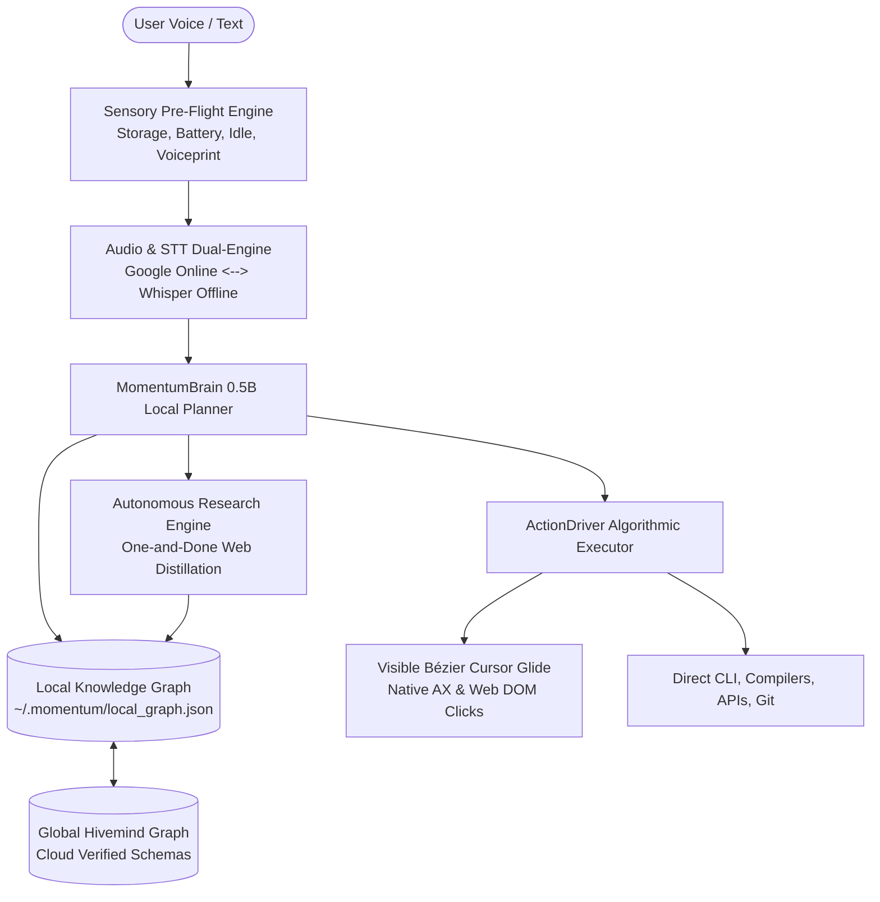
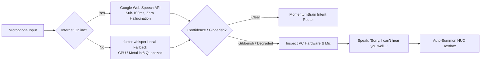
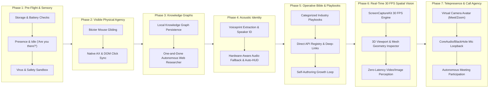

# Momentum AI — Autonomous Agency & Cognitive Operating System Specification

> **Version:** 2.0-Alpha  
> **Target Platform:** macOS (Apple Silicon Metal) & Windows  
> **Model Core:** `momentum-engine-tiny-0.5b.gguf` (Local quantized LLM on Metal GPU)  
> **Runtime Latency Target:** Sub-200ms spoken audio, 0ms input dispatch  

---

## 1. Executive Vision: Human and Superhuman OS Companion

Momentum is a local-first, voice-native autonomous operating system companion. It pairs a **0.5B cognitive planner** with an **algorithmic physical executor (`ActionDriver`)**. 

Momentum is designed to behave like a sharp, funny, and proactive human pair-programmer sitting beside the user—physically looking at windows, gliding the cursor, clicking buttons, and remembering user preferences—while retaining superhuman capabilities for bulk automation, instant CLI tool execution, and global knowledge retrieval.

---

## 2. Core Architectural Pillars

---

## 3. The Dual Knowledge Graph Architecture

A 0.5B model cannot hold the entire internet in its raw weights. Instead of hardcoding brittle platform logic or retraining models, Momentum uses a **Self-Building Dynamic Knowledge Graph**.

### 3.1 Local Knowledge Graph (`~/.momentum/local_graph.json`)
The local graph lives entirely on the user's SSD. It is completely private and continually evolving:

1. **User Identity & Personality Matrix**:
   * Name, preferred communication style (sarcastic, funny, concise, technical).
   * Project directories, common repositories, frequently used tools.
2. **Speaker & Voiceprint Profiles**:
   * Acoustic voice embedding vectors (e.g. Danny, Amanda, Sanjeev).
   * Individual permissions and conversational context per speaker.
3. **Learned Workflow Shortcuts (The One-and-Done Rule)**:
   * **Rule:** The first time Momentum navigates an application or website to accomplish a goal (e.g., exporting a low-poly asset from Blender, filtering B2B leads on a job board), it records the state-transition path into its Local Knowledge Graph.
   * **Next Time:** Momentum skips research entirely and executes the stored shortcut directly at maximum speed.

### 3.2 Global Knowledge Graph (The Hivemind)
A hosted, shared repository accessible only by authenticated Momentum agents:
* When a Momentum instance anywhere in the world successfully maps a new SaaS dashboard, web app DOM, or desktop application layout, it submits the verified state-transition schema.
* Other instances download the pre-compiled graph in milliseconds without having to discover the surface from scratch.

---

## 4. Autonomous Research & Knowledge Distillation

When the user asks for a task in an unknown domain (e.g., *"Make a PCB circuit schematic"* or *"Find bio-tech grant funding"*):

1. **Spoken Acknowledgment**:
   * Momentum notifies the user with personality:  
     `"Hold on, let me research that real quick..."`
2. **Autonomous Web Discovery**:
   * Runs a rapid background query against documentation, developer registries, and developer forums.
3. **Knowledge Distillation**:
   * Strips marketing copy and extracts:
     * **Top 3 Tools/Platforms** (Desktop native vs Web).
     * **Required User Parameters** (Format, target engine, industry).
     * **Core Action Pipeline** (New Project → Editor → Export).
4. **Library Generation**:
   * Writes the distilled schema into the Local Knowledge Graph.
5. **Interactive Clarification**:
   * Returns to the user with informed, contextual questions:  
     `"Alright, I found KiCad for desktop and EasyEDA for browser. What kind of circuit are we designing?"`

---

## 5. Sensory Awareness & Pre-Flight Checks

Before taking physical or computational action, Momentum assesses the machine's physical hardware state:

| Check | Metric / API | Threshold | Momentum Behavior |
| :--- | :--- | :--- | :--- |
| **SSD Storage** | `statvfs` / `df` | `< 2.0 GB` free | Stops heavy downloads/renders; warns user: *"Whoa, hold up. You’ve only got 1.2 GB left on your SSD. Want me to clear out some downloads first?"* |
| **Battery & Power** | `pmset -g batt` / IOKit | `< 15%` & unplugged | Alerts user before heavy GPU/CPU operations: *"Your battery is at 12% and unplugged. Let's plug in before compiling."* |
| **User Presence** | Mouse/Keyboard idle time | `> 2 minutes` idle | Pauses spoken interruptions; when user returns or wakes the machine: *"Hey... are you there?"* |
| **Virus & Safety** | Hash check & heuristic scan | Unverified downloads / shell scripts | Blocks dangerous shell commands (`rm -rf /`, `curl \| sh`); scans downloads before execution. |

---

## 6. Audio Pipeline Resilience & Hardware-Aware Fallback

1. **Primary Online Engine**: Google Web Speech API for near-zero latency and high accuracy.
2. **Offline Fallback**: Seamless fallback to native `faster-whisper` (int8) when internet connectivity drops.
3. **Hardware-Aware Audio Degradation**:
   * If input is unintelligible or noise floor is high, Momentum inspects machine specs (CPU load, mic sample rate).
   * Responds with empathy and personality:  
     `"Sorry, I can't hear you that well right now — might be because of background noise or your mic input. Talk to me using the textbox instead!"`
   * Automatically invokes `show_window_now` and focuses the HUD text input.

---

## 7. Physical Interaction: Human vs. Superhuman Modes

### 7.1 Human Mode (Visible Desktop Agency)
To ensure the user visually sees and trusts Momentum's actions:
* **Smooth Bézier Cursor Gliding**: Replaces instant `0ms` coordinate teleporting with a smooth 200–300ms Bézier trajectory with natural human ease-in and ease-out deceleration.
* **Hover State & Visual Accent**: The cursor hovers on target buttons for 40ms before clicking, activating native OS button hover animations.
* **Natural Keystroke Cadence**: Character inputs type with realistic keystroke delays (20–45ms per character) rather than instantaneous memory pasting.

### 7.2 Superhuman Mode (Instant Automation)
When raw developer speed is requested:
* **CLI Execution**: Runs terminal builds, Docker tasks, and tests directly in sandboxed subshells.
* **CDP Automation**: Direct DOM element dispatch for bulk web scraping and form filling.
* **File System Operations**: Directly parses, compiles, and formats project repositories.

---

## 8. Implementation Roadmap

| Phase | Milestone | Key Deliverables |
| :--- | :--- | :--- |
| **Phase 1** | **Pre-Flight & Sensory Checks** | Storage limits (`statvfs`), battery percentage & power awareness (`pmset`), 2-min user idle presence detection (*"Hey, are you there?"*), command/payload safety scan. |
| **Phase 2** | **Visible Physical Agency** | Natural Bézier curve mouse gliding (200–300ms ease-out), button hover states, human keystroke delays, synchronized native macOS Accessibility & DOM clicks. |
| **Phase 3** | **Knowledge Graphs & Web Research** | ✅ **COMPLETED**: Persistent `~/.momentum/knowledge_graph.json`, **One-and-Done** research pipeline (learns once, recalls in 0ms next time), entity graph, verified via `./test_kg.sh`. |
| **Phase 4** | **Acoustic Identity & Speech Resilience** | Acoustic voiceprint embeddings (speaker ID for Danny, Amanda, etc.), Google online <-> Whisper offline fallback, gibberish detection with hardware awareness & auto-HUD textbox summon. |
| **Phase 5** | **The Operative Bible & Capability Engine** | Universal playbook across 3D, Photoshop, Game Dev, Web Development, AI Apps, Daily OS Tasks, and Client Sourcing. Direct public API registry, platform deep-links, and self-authoring commit loop (`~/.momentum/bible/`). |
| **Phase 6** | **Real-Time 30 FPS Spatial Vision & 3D Inspection** | Native `ScreenCaptureKit` 30 FPS frame pipeline, spatial attention maps, 3D viewport parser (mesh geometry, wireframes, UVs, textures in Blender/Unreal), sub-100ms visual QA loop. |
| **Phase 7** | **Virtual Call Telepresence & AV Loopback** | Momentum joins video calls (Google Meet, Zoom, Discord). Virtual camera driver projecting Momentum's animated face/avatar + Virtual mic driver (CoreAudio / BlackHole loopback) routing Momentum's voice directly into the conference call stream. |

